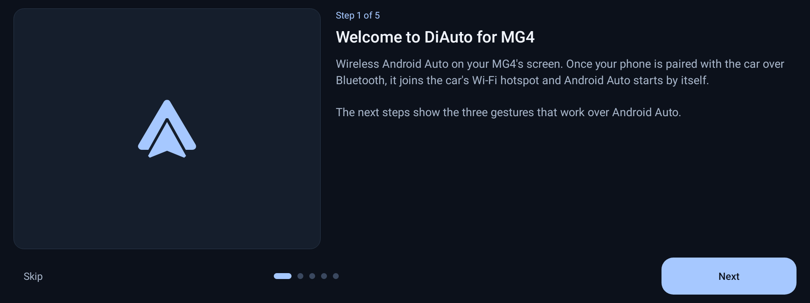
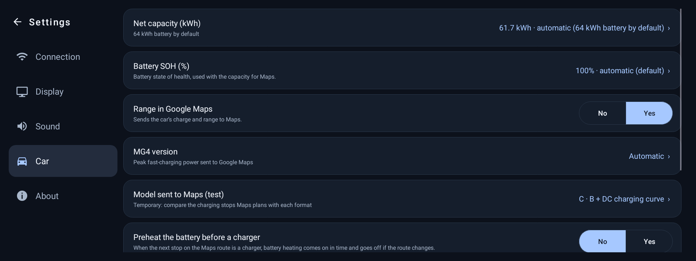
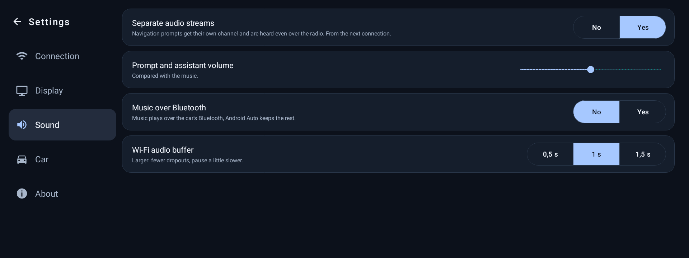
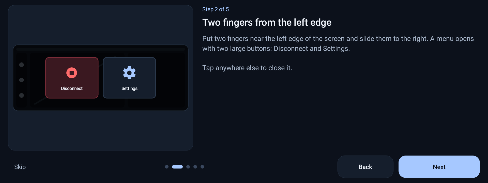
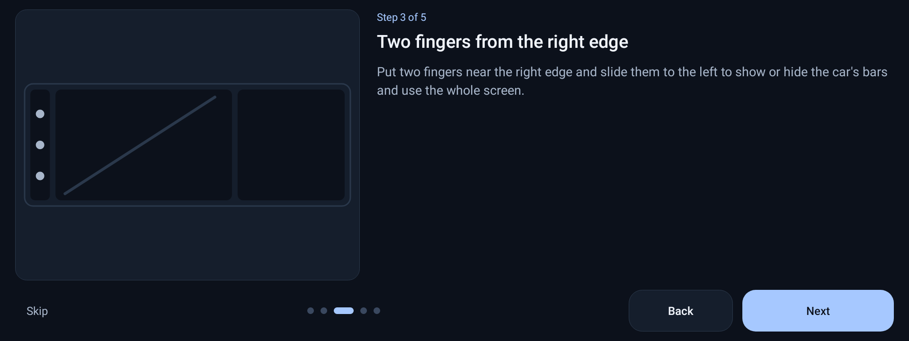
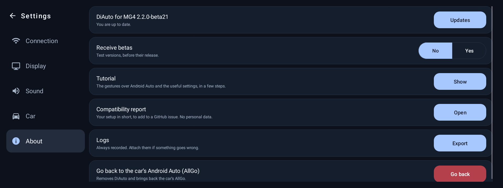

# DiAuto MG4+

**Wireless Android Auto for the MG4's screen**, built for the car. It replaces the car's own
Android Auto, connects by itself when you get in, and gives Google Maps your MG4's battery so Maps
can plan your charging stops.

> Community fork of [DiAuto](https://github.com/shihabal3amri/DiAuto) (AGPL-3.0), via
> [merthankaraman/DiAuto-MG4](https://github.com/merthankaraman/DiAuto-MG4), maintained separately
> for the MG4 (SWI69 head unit) with its own version line. MG4 data comes from the vendored
> [EVHardware](https://github.com/fatihdonmezdev/MG4ABRP) library. For Apple CarPlay, use
> **DiPlay-MG4** instead (do not run both at once).

<p align="center"></p>

## What it does

### Android Auto, wireless and automatic
- Once your phone is paired with the car over Bluetooth, it joins the car's own Wi-Fi hotspot and
  Android Auto starts by itself every trip. A USB cable works too.
- DiAuto installs as an **update of the car's original Android Auto app** (AllGo). The car's
  launcher sees it as its Android Auto: the Android Auto tile works and the media card shows the
  song, artist and cover.
- Steering wheel keys work as with the original: previous / next, play / pause, voice assistant
  (Google Assistant / Gemini) and the phone key.

### Internet in the car from the phone (Android Auto over USB)
Many MG4s have their own 4G connection, but not in every country, and it comes with a monthly data
allowance after which it stops. The phone can take over: with wireless Android Auto the car's Wi-Fi
is busy being the hotspot your phone joins, but with Android Auto on the **USB cable** it is free.
DiAuto then switches the car's Wi-Fi client on, and the car joins the networks it knows, such as
your phone's Wi-Fi hotspot:
1. Turn on your phone's Wi-Fi hotspot.
2. Once, in the car's *Settings → Wi-Fi*, connect to that hotspot (the car remembers it).
3. From then on, plug the phone in: Android Auto starts over USB and the car joins the hotspot by
   itself. When the cable is unplugged, the car's Wi-Fi client goes off again, ready for wireless
   Android Auto next time.

The option is *Settings → Connection → Car Wi-Fi with USB*, on by default. Sharing the phone's
internet over Bluetooth is not possible on the MG4: its Bluetooth stack has no network profile.

### Google Maps as an EV trip planner
- DiAuto sends Maps the battery level, range, consumption and the **real fast-charging power of your
  MG4 version** (Standard 51 kWh, Comfort / Luxury / XPower 64 kWh, Extended Range 77 kWh). Maps
  then shows the battery at arrival and adds charging stops to long routes.
- The version, net battery capacity and state of health are detected from the car. Each can be
  changed in *Settings → Car*, with a button to go back to automatic.
- **Battery preheating before a charging stop** (off by default): when the next stop on the Maps
  route is a charger, DiAuto turns battery heating on a set time before you arrive (30 min by
  default, 5 to 60 min) and turns it off again if the route changes.

<p align="center"></p>

### Sound
- Navigation prompts and the assistant get their own channel, so they are heard over the radio or
  your music, at a voice level you choose (up to +200 %).
- Music plays over Android Auto by default. *Music over Bluetooth* keeps the music on the car's
  Bluetooth and the rest on Android Auto.

<p align="center"></p>

### Simple screens, in your language
- A home screen and settings in five tabs (Connection, Display, Sound, Car, About) with large
  buttons, in the car's language (22 languages).
- A short **tutorial** at first start shows the gestures and the main features. It can be skipped,
  and shown again from *Settings → About*.
- Updates from this repository, from the app (*Settings → About*, betas optional).

## Gestures over Android Auto

| Gesture | What it does |
| --- | --- |
| Two fingers from the **left** edge, slide right | Menu with **Disconnect** and **Settings** |
| Two fingers from the **right** edge, slide left | Full screen: hides the car's side bar and top strip (Android Auto reconnects for a few seconds to use the new height). Same gesture to bring them back. |
| Three fingers **down** | Disconnects Android Auto and goes back to DiAuto's home screen |

<p align="center">
  
  
</p>

## Install

1. Download `DiAuto-MG4_<version>.apk` from the [Releases](https://github.com/Skittle6938/DiAuto-MG4/releases)
   page and copy it to a USB stick.
2. On the car, open the **Files** app. If you have never installed an app on the car:
   1. Open **Bluetooth Settings** and select the car's name.
   2. Hold down the **comma** key until the keyboard settings appear.
   3. Select **Android Keyboard Settings → Languages**.
   4. Search for **file** with the search box at the top: this opens the **Files** app.
3. Select the USB stick and install the APK. It installs on top of the car's Android Auto.
4. Pair your phone with the car over Bluetooth if it is not already, then open DiAuto.

**Coming from 2.0.x** (`com.drivehub.diauto.mg4`): install the new APK once by hand. At first start
it takes over the old settings, then removes the old DiAuto.

## Going back to the car's Android Auto

*Settings → About → Go back to the car's Android Auto (AllGo)*, then restart the screen by holding
the **Home** button for 20 s. This removes DiAuto and its settings; the original app was never
deleted and comes back as it was. The same can be done in Android's settings (*Apps → Android Auto →
Uninstall updates*) or with `adb shell pm uninstall com.allgo.app.androidauto`.

## Tips

- **Google Assistant / Gemini closes right away** (the listening animation shows, then stops before
  you speak): unlock the phone and try again. On some phones Gemini cancels at once while the phone
  is locked, even with *Use Gemini without unlocking* on. Keeping the phone unlocked in the car (for
  example with Android's *Extend Unlock* / Smart Lock and the car as a trusted Bluetooth device)
  avoids it.

## Reporting a problem

Open an [issue](https://github.com/Skittle6938/DiAuto-MG4/issues) and add:
- *Settings → About → Compatibility report*: a short summary of your setup (car firmware, Android,
  DiAuto settings), with no personal data.
- *Settings → About → Logs → Export*, taken right after the problem.

<p align="center"></p>

## Build

The car build is signed with the head unit's platform key (`android.uid.system`, needed for the
car's battery and climate data). The keys are not in this repository.

```powershell
$env:MG4_PLATFORM_KEYS_DIR = "C:\path\to\platform-keys"  # platform.pk8 + platform.x509.pem
powershell -File scripts\build_mg4.ps1
```

A phone / tablet build with a demo battery: `powershell -File scripts\build_phone.ps1`. In Android
Studio, open the project and pick **carDebug** or **phoneDebug**. Tests: `gradlew testCarDebugUnitTest`.

See [CHANGELOG.md](CHANGELOG.md) for what changed in each version and
[docs/MG4_TESTING.md](docs/MG4_TESTING.md) for the in-car checklist.

## License

AGPL-3.0, like DiAuto. See [LICENSE](LICENSE) and [docs/THIRD_PARTY.md](docs/THIRD_PARTY.md).
